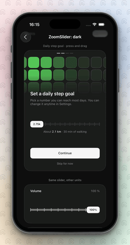
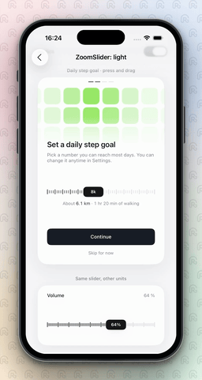

<div align="center">

| Dark | Light |
| :---: | :---: |
|  |  |

</div>

<h1 align="center">ZoomSlider</h1>

A SwiftUI slider for picking a number from a long range. Press the pill and it opens into a bubble that magnifies the ticks under your finger.

[](#)
[](./LICENSE)
[](#installation)
[](#contributing)

* * *

## ✨ Features

- 🔍 **Zoom bubble**: a small pill grows into a bubble with the full number while you press
- 📏 **Easy to be precise**: the ticks under your finger spread out, so each step is easy to land on
- 🎯 **Reaches both ends**: drag from the first tick to the last, even on the smallest and largest values
- 🧲 **Snaps to steps**: one tick per step, with a taller tick every few steps (`majorEvery`)
- 🌫️ **Press and release callback**: blur or dim the rest of your screen while the bubble is open
- 🎨 **Your colors**: dark and light presets, or `.accent(_:)` for any color
- 🏷️ **Your labels**: show values your way (`8k`, `$1.5k`, `7h30`)
- ⏱️ **Tunable motion**: set how fast it opens, closes and follows your finger
- 📳 **Haptics**: a soft tap when the bubble opens and a tick on every step
- ♿ **Accessible**: works with VoiceOver, and skips the animation when Reduce Motion is on

* * *

## Installation

**Swift Package Manager**: Xcode → *File → Add Package Dependencies…* and enter
`https://github.com/ismnoiet/zoom-slider-ios`, or in `Package.swift`:

```swift
.package(url: "https://github.com/ismnoiet/zoom-slider-ios", from: "1.0.0")
```

then add the `ZoomSlider` product to your target and `import ZoomSlider`.

**CocoaPods** (experimental)

```ruby
pod 'ZoomSlider', '~> 1.0'
```

### Requirements

| Platform | Minimum |
|---|---|
| iOS | 17.0 |
| macOS | 14.0 |
| visionOS | 1.0 |
| Swift / Xcode | 5.9 / 15 |

* * *

## Quick start

```swift
import ZoomSlider

struct StepGoal: View {
    @State private var steps = 8000

    var body: some View {
        ZoomSlider(value: $steps)            // 2,000...16,000 in steps of 250
            .padding(.horizontal, 26)
    }
}
```

Other ranges and units:

```swift
ZoomSlider(value: $volume, bounds: 0...100, step: 1, majorEvery: 10, unit: "%")
ZoomSlider(value: $budget, bounds: 0...10_000, step: 250, unit: "/ month",
           compactLabel: { "$" + ZoomLabels.compact($0) },       // pill:   $1.5k
           fullLabel:    { "$" + ZoomLabels.grouped($0) })       // bubble: $1,500
```

On a dark surface, or in your own color:

```swift
ZoomSlider(value: $steps, style: .paper)
ZoomSlider(value: $steps, style: .accent(.green))
```

React to pressing, for example to blur everything else:

```swift
ZoomSlider(value: $steps, onEditingChanged: { editing in blurTheRest = editing })
```

* * *

## Props

| Prop | Type | Default | Description |
|---|---|---|---|
| `value` | `Binding<Int>` | n/a | The selected value |
| `bounds` | `ClosedRange<Int>` | `2000...16000` | Smallest and largest value |
| `step` | `Int` | `250` | Values snap to multiples of this, one tick per step |
| `majorEvery` | `Int` | `4` | Every Nth tick is taller (1,000 steps here) |
| `unit` | `String` | `"steps"` | Small text next to the big number in the bubble; `""` for none |
| `style` | `ZoomSliderStyle` | `.ink` | Colors, see below |
| `timing` | `ZoomTiming` | `.default` | Spring timing |
| `haptics` | `Bool` | `true` | Tap on press, tick on every step |
| `accessibilityName` | `String` | `"Value"` | VoiceOver label |
| `compactLabel` | `(Int) -> String` | `ZoomLabels.compact` | Text in the idle pill |
| `fullLabel` | `(Int) -> String` | `ZoomLabels.grouped` | Big number in the bubble |
| `onEditingChanged` | `(Bool) -> Void` | no-op | `true` when a press starts, `false` when it ends |

> The slider fills the width you give it and is 100 pt tall. While you press, the bubble rises about 44 pt above the ruler and may hang 20 pt past either end of it, so leave some room around the slider.

`ZoomSlider.progress(of:bounds:step:)` returns a value's position as `0...1`, handy for driving something that follows the slider (a glow, a progress ring).

* * *

## Styles

| Style | Look |
|---|---|
| `.ink` | Near-black pill and ticks, white bubble, for light surfaces (default) |
| `.paper` | Near-white pill and ticks, graphite bubble, for dark surfaces |
| `.accent(_:)` | A colored pill, ticks and bubble number |

Or build your own:

```swift
let brand = ZoomSliderStyle(
    pill: .indigo, pillLabel: .white,
    bubble: .white, bubbleLabel: .indigo, bubbleSecondary: .gray,
    tickOn: .indigo, tickOff: .indigo.opacity(0.2), tickOffZoomed: .indigo.opacity(0.35),
    shadow: .indigo.opacity(0.3)
)
```

* * *

## Labels

`ZoomLabels` has the two formatters the defaults use:

| Function | 8250 | 16000 | 750 |
|---|---|---|---|
| `ZoomLabels.compact` | `8.25k` | `16k` | `750` |
| `ZoomLabels.grouped` | `8,250` | `16,000` | `750` |

Pass any `(Int) -> String` for anything else; the same value is formatted twice, once for the pill and once for the bubble.

* * *

## Timing

```swift
ZoomSlider(value: $v, timing: ZoomTiming(open: 0.6, close: 0.55, follow: 0.3))   // slow and soft
```

| `ZoomTiming` field | Default | Description |
|---|---|---|
| `open` | `0.34` | Seconds for the pill to open into the bubble |
| `close` | `0.32` | Seconds for the bubble to collapse and settle on a tick |
| `follow` | `0.14` | Seconds for the thumb and lens to catch up with your finger |

The open spring is slightly under-damped, so the bubble pops open with a little overshoot.

* * *

## How it behaves

- **Grabbing.** Press the pill anywhere and the value stays put; the thumb then follows your finger. Press empty ruler and the thumb jumps there.
- **Both ends.** Drag past either end and the value pins to the first or last tick.
- **Snapping.** The label changes on every step. The thumb moves smoothly while you drag and settles onto the nearest tick on release.
- **Driving it from code.** Change the bound value and the pill glides there (not while a press is in charge).
- **Bounds.** Use bounds a multiple of `step` apart; a trailing partial step is unreachable.

> Inside a `ScrollView`, a vertical swipe that starts on the slider is taken by the slider. Leave some space around it.

* * *

## Example app

Open `Package.swift` in Xcode, choose the `ZoomSliderDemo` scheme and use the preview, or show `ZoomSliderExamples()` (dark) or `ZoomSliderExamplesLight()` from an app.

| Demo | Shows |
|---|---|
| Daily step goal | The hero: the rest of the card blurs while you press, the tile glow follows the value |
| Other units | Volume, thermostat, sleep goal and budget with custom labels |
| Drive it from code | Preset chips that glide the slider |
| Your colors | `.accent(_:)` in blue, green and orange |
| Heavy springs | Slower `ZoomTiming` |

Source: [`DemoSupport.swift`](./Sources/ZoomSliderDemo/DemoSupport.swift), [`StepGoalCard.swift`](./Sources/ZoomSliderDemo/StepGoalCard.swift), [`Examples.swift`](./Sources/ZoomSliderDemo/Examples.swift), [`ExamplesLight.swift`](./Sources/ZoomSliderDemo/ExamplesLight.swift)

* * *

## How it works

The ruler is one `Canvas`. Each tick is mapped through a small fisheye function: inside the lens ticks spread apart by up to 1.75× at your finger and ease back to normal spacing at the lens edge, so ticks outside it never move. Ticks inside the lens also grow taller and thicker, and the ones after the value brighten.

The pill and the bubble are the same rounded rectangle at two sizes. A single number `z` (0 = pill, 1 = bubble) drives its size, corner radius, fill, shadow and which label shows, and the position along the ruler is another number; the track view is `Animatable` over both, so SwiftUI's springs animate every tick frame by frame. The ruler is drawn on top of the bubble so the magnified ticks sit inside it.

The geometry and value math lives in `ZoomMath.swift`, free of SwiftUI state, and is unit-tested.

* * *

## Tests

```sh
swift test
```

The pure math (snapping, positions, the lens, grabbing, labels) is covered in [`ZoomMathTests.swift`](./Tests/ZoomSliderTests/ZoomMathTests.swift).

* * *

## 💡 Inspiration

Inspired by the great work of: [@kshvbgde on X](https://x.com/kshvbgde/status/2121127151902871946). This is an independent implementation.

* * *

## ⭐ Support

If you find this useful, give the repo a star.

## Contributing

Issues and PRs are welcome.

## License

MIT © [ismnoiet](https://github.com/ismnoiet)
